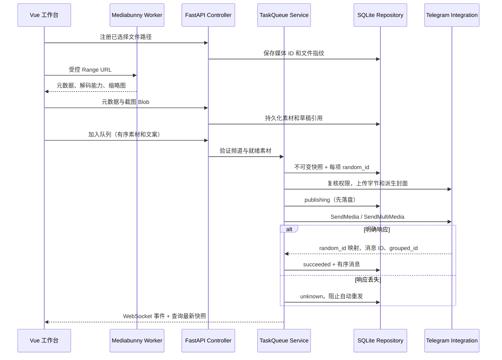

# 开发说明

## 分层与调用链

熟悉 Controller / Service / Repository 的开发者可按同样方式理解本项目：API 负责校验和错误响应，Service 决定业务规则，Repository 执行短事务，Integration 封装 Telegram / HTTPX / Pillow。Vue 不直接访问数据库。

## 异步边界

Python 一个 Uvicorn worker、一个 asyncio 事件循环维护 Telethon 和队列，文件字节流不进入 JSON。Repository 用 asyncio 锁序列化事务，在线程中执行 SQLite，避免阻塞事件循环；Pillow 图片生成和文件写入使用线程。每次事务关闭 Session，不跨异步操作复用 Session。

队列先准备全部媒体的服务器引用，再执行最终发送。`messages.UploadMedia` 不发布消息，最终 `SendMedia` / `SendMultiMedia` 才跨越发布边界。发送前将 publishing 落盘；不确定结果永远不伪装为明确失败。对明确 FloodWait 响应等待服务端规定的秒数，允许取消；准备阶段网络重试最多三次，最终发送不做通用盲重试。

random_id 保存为十进制字符串，避免 JavaScript 的整数精度损失；调用 MTProto 时恢复为 Python int。标题加粗和 hashtag 实体按 UTF-16 偏移计算，用户输入不做 Markdown / HTML 解析。

上传使用 `integrations/uploader.py`：512 KiB 分块、默认 4 个未完成保存请求，可在设置中配置为 1～10，确认字节后累加进度。`TelegramGateway._upload_file` 对视频、照片、缩略图和封面统一在文件开始时读取最新设置，当前文件的窗口固定；常规设置保存不重连 Telegram，实际连接参数变更继续受活动任务保护。`services/reporting.py` 独立合并和保存进度，上传回调不等待数据库；最终发送前排空报告协程。cryptg 提供随包分发的原生 AES-IGE 加速，打包脚本会启动产物检查真实后端，禁止无声回退。协议限流仍按服务端等待，最终发布去重边界不变。

## 前端媒体

`media/engine.ts` 是唯一的 Mediabunny 适配入口：UrlSource 限制缓存、Input 读取轨道、canDecode 检查 WebCodecs、CanvasSink 应用旋转与画面尺寸。逐帧依据轨道时间分辨率与实际呈现时间，不假定 30fps。

Worker 生成十个采样缩略图并持久化；播放器切换时暂停旧播放、销毁 Input / 音频上下文；生命周期序号防止旧异步结果覆盖新素材。自定义播放最多提前调度一小段音频，画布池固定大小。已入队任务所需素材在 Python 侧可用，后台上传不依赖页面继续取帧。

## 安全边界

Electron 启用 sandbox、contextIsolation，关闭 nodeIntegration，禁用外部导航与新窗口。preload 仅暴露文件选择、拖入路径、目录选择、日志和窗口能力；所有 IPC 校验主 frame 来源。生产资源使用 app://bundle 自定义协议，拒绝目录穿越。

Python 仅绑定 127.0.0.1 动态端口；HTTP / WebSocket 校验每次启动生成的随机令牌与精确 Origin。原生媒体元素因无法设置自定义请求头，使用仅本次启动有效的 URL token；关闭访问日志，应用日志不记录完整 URL / 请求头。文件读取只接受已注册的媒体 ID，服务端核对文件指纹。

## 开发约定

- 修改 API 模型时同步 `frontend/src/types.ts` 与对应业务测试。
- 业务模型使用 Pydantic 严格字段；不要把任意前端数据直接写入任务。
- 测试使用 FakeGateway / MemorySecrets，禁止普通测试向 Telegram 发消息。
- 依赖更新需同时提交 package-lock.json / backend/uv.lock，并重跑媒体样本和打包检查。
- 不引入 FFmpeg、WASM 转码或自动安装解码器。
